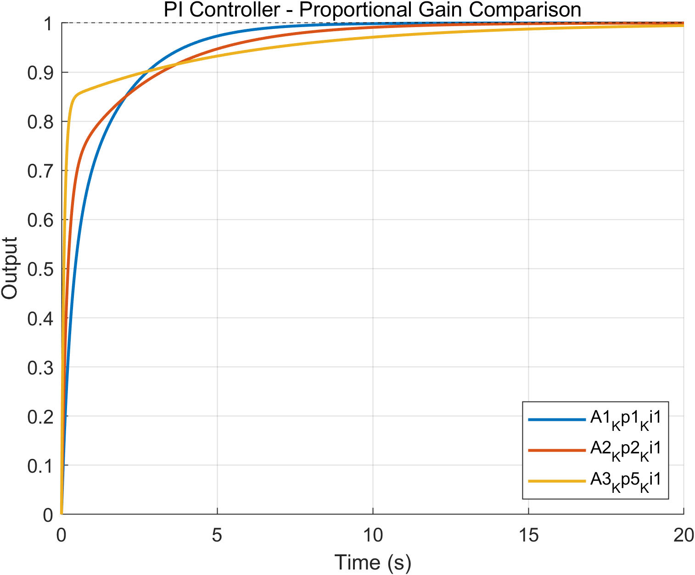
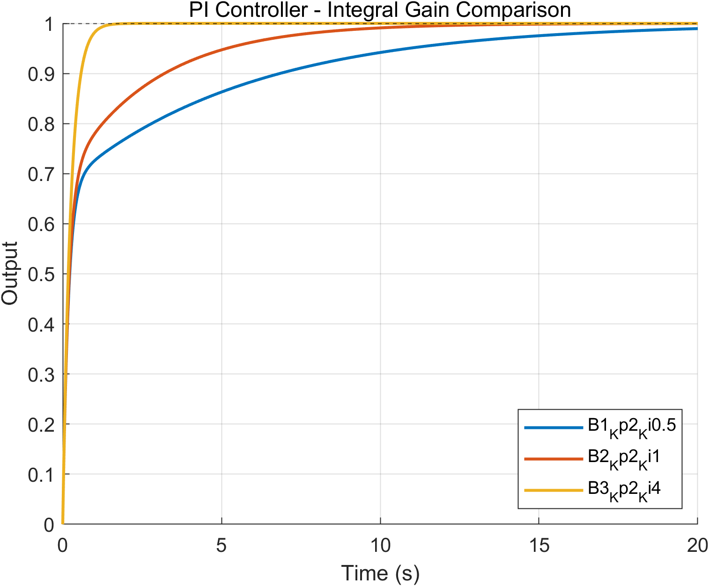

# Experiment 01 — PI Controller Analysis Based on Simulink

**Project:** Embedded Motion Control Lab
**Category:** Control System Modeling and Simulation
**Tool:** MATLAB / Simulink
**Controller:** PI Controller
**Status:** Completed - Initial Simulation

## 1. Experiment Objectives

The objectives of this experiment are:

1. Understand the basic structure of a PI feedback control system.
2. Build a closed-loop control system using MATLAB/Simulink.
3. Investigate the effects of proportional gain (Kp) and integral gain (Ki) on system response.
4. Observe the relationship between controller parameters and transient response.
5. Develop a basic understanding of controller parameter tuning.

## 2. Plant Model

The plant used in this experiment is a first-order transfer function:

$$
G(s)=\frac{1}{0.5s+1}
$$

Where:

- Numerator: 1
- Denominator: 0.5s + 1
- Plant time constant: 0.5 s
- DC gain: 1

The plant is used to investigate the dynamic response of a PI-controlled system.

## 3. PI Controller Design

The PI controller is defined as:

$$
C(s)=K_p+\frac{K_i}{s}
$$

Where:

- Kp: Proportional gain
- Ki: Integral gain

The controller can also be expressed as:

$$
C(s)=\frac{K_ps+K_i}{s}
$$

For a unity negative feedback system, the open-loop transfer function is:

$$
L(s)=C(s)G(s)
$$

Substituting the plant and controller:

$$
L(s)=\frac{K_ps+K_i}{s(0.5s+1)}
$$

The closed-loop transfer function is:

$$
T(s)=\frac{L(s)}{1+L(s)}
$$

After simplification:

$$
T(s)=
\frac{K_ps+K_i}
{0.5s^2+(1+K_p)s+K_i}
$$

The characteristic equation is:

$$
0.5s^2+(1+K_p)s+K_i=0
$$

## 4. Simulink Model and Simulation Setup

The control system was constructed using MATLAB/Simulink.

The model consists of:

- Step reference input
- Error calculation
- PI controller
- First-order plant
- Unity negative feedback
- Scope for observing the output response

The PI controller was implemented using the built-in PID Controller block configured in PI mode.

**Model file:** `PI_Control_Model.slx`

**Simulation configuration:**

| Parameter            | Configuration           |
| -------------------- | ----------------------- |
| Plant                | 1 / (0.5s + 1)          |
| Controller           | PI mode                 |
| Input signal         | Unit step input         |
| Feedback             | Unity negative feedback |
| Simulation stop time | 20 s                    |
| Observation tool     | Simulink Scope          |
| Data analysis        | MATLAB scripts          |

The same Simulink model was used for all six experiments. The controller parameters were modified automatically through a MATLAB script, while the other simulation conditions remained unchanged.

The simulation results were saved and analyzed using MATLAB. Performance indicators were calculated and exported into CSV format for further comparison.

## 5. Experimental Design

Six simulation runs were conducted using the same Simulink model. Only the PI controller parameters were changed between simulations.

The experiments were divided into two groups to investigate the individual effects of proportional gain and integral gain.

### 5.1 Experiment A: Proportional Gain Analysis

The integral gain was fixed at:

$$
K_i=1
$$

The proportional gain was changed across three values:

| Experiment | Kp   | Ki   |
| ---------- | ---- | ---- |
| A1         | 1    | 1    |
| A2         | 2    | 1    |
| A3         | 5    | 1    |

The objective was to investigate how changes in proportional gain affect the closed-loop response.

### 5.2 Experiment B: Integral Gain Analysis

The proportional gain was fixed at:

$$
K_p=2
$$

The integral gain was changed across three values:

| Experiment | Kp   | Ki   |
| ---------- | ---- | ---- |
| B1         | 2    | 0.5  |
| B2         | 2    | 1    |
| B3         | 2    | 4    |

The objective was to investigate how changes in integral gain affect the closed-loop response.

### 5.3 Experimental Conditions

The same Simulink model was used for all six simulation runs.

The controller parameters were the only intended variables changed between experiments. Other simulation conditions should remain consistent to ensure a meaningful comparison.

## 6. Experimental Results

### 6.1 Quantitative Performance Results

To evaluate the PI controller performance more accurately, MATLAB scripts were used to calculate the response characteristics of all six experiments.

The calculated performance indicators include rise time, settling time, overshoot and terminal output error at the simulation stop time.

The performance indicators were calculated using
the following definitions:

- Rise time: Time required for the output to rise
  from 10% to 90% of the reference value.
- Settling time: Time required for the output to
  enter and remain within the ±2% reference band.
- Overshoot: Maximum percentage by which the
  output exceeds the reference value.
- Terminal error: Absolute output error at the
  simulation stop time of 20 seconds.

The results are summarized below:

| Experiment |   Kp |   Ki | Rise Time (s) | Settling Time (s) | Overshoot (%) | Terminal Error (%) |
| ---------- | ---: | ---: | ------------: | ----------------: | ------------: | -----------------: |
| A1         |    1 |    1 |         2.694 |             5.495 |             0 |           0.000408 |
| A2         |    2 |    1 |         3.176 |             7.746 |             0 |           0.026051 |
| A3         |    5 |    1 |         2.658 |            12.189 |             0 |           0.534041 |
| B1         |    2 |  0.5 |         6.811 |            16.218 |             0 |           1.045297 |
| B2         |    2 |    1 |         3.176 |             7.746 |             0 |           0.026051 |
| B3         |    2 |    4 |         0.549 |             0.978 |             0 |                 ≈0 |

The results show that different PI parameter combinations produce significantly different transient responses.

Note: Terminal error represents the output error at the end of the 20-second simulation, rather than the theoretical steady-state error.

### 6.2 Proportional Gain Comparison

In Experiment A, the integral gain was fixed at Ki = 1, while the proportional gain was varied from 1 to 5.

The results show that:

- Kp = 1: Rise time was 2.694 s and settling time was 5.495 s.
- Kp = 2: Rise time was 3.176 s and settling time was 7.746 s.
- Kp = 5: Rise time was 2.658 s and settling time was 12.189 s.

The response characteristics did not improve monotonically with increasing proportional gain.

Although Kp = 5 produced a relatively rapid initial response, its settling time was the longest among the three experiments.

No noticeable overshoot was observed in these experiments.

These results indicate that increasing proportional gain does not necessarily reduce the overall settling time.

### 6.3 Integral Gain Comparison

In Experiment B, the proportional gain was fixed at Kp = 2, while the integral gain was varied from 0.5 to 4.

The results show that:

- Ki = 0.5: Rise time was 6.811 s and settling time was 16.218 s.
- Ki = 1: Rise time was 3.176 s and settling time was 7.746 s.
- Ki = 4: Rise time was 0.549 s and settling time was 0.978 s.

As the integral gain increased from 0.5 to 4, both rise time and settling time decreased significantly. The settling time decreased from 16.218 s to 0.978 s.

No noticeable overshoot was observed in the tested parameter range.

These results indicate that increasing integral gain improved the transient response of this particular plant within the tested parameter range. This trend should not be assumed to continue for arbitrarily large integral gains.

### 6.4 Simulation Figures

**Experiment A — Proportional Gain Comparison**

**Experiment B — Integral Gain Comparison**

## 7. Result Analysis and Discussion

### 7.1 Influence of Proportional Gain

In Experiment A, the integral gain was fixed at Ki = 1, while the proportional gain was increased from 1 to 5.

The experimental results show that the response characteristics did not improve monotonically with increasing proportional gain.

Although Kp = 5 produced a relatively short rise time, its settling time was the longest among the three experiments.

The settling time increased from 5.495 s to 12.189 s as Kp increased from 1 to 5.

This indicates that a faster initial response does not necessarily result in a shorter overall settling time.

Therefore, proportional gain should be evaluated based on multiple performance indicators rather than response speed alone.

### 7.2 Influence of Integral Gain

In Experiment B, the proportional gain was fixed at Kp = 2, while the integral gain was increased from 0.5 to 4.

The results show that both rise time and settling time decreased significantly.

The settling time decreased from 16.218 s to 0.978 s.

This indicates that increasing integral gain significantly improved the transient response of the tested system within the selected parameter range.

However, excessively large integral gain may cause overshoot, oscillation or instability. Therefore, the observed trend should not be generalized to arbitrary parameter ranges.

### 7.3 Relationship Between Closed-loop Poles, Controller Zeros and Transient Response

To further understand the experimental results, the closed-loop poles and PI controller zeros were analyzed.

The closed-loop characteristic equation is:

$$
0.5s^2+(1+K_p)s+K_i=0
$$

The zero of the PI controller is:

$$
s_z=-\frac{K_i}{K_p}
$$

The closed-loop poles determine the exponential decay rates of the system's transient components, while the controller zero affects their relative amplitudes.

#### 7.3.1 Analysis of Proportional Gain

When Ki = 1, the closed-loop poles and PI controller zero are:

| Kp   | Slow Pole | Fast Pole | PI Zero |
| ---- | --------- | --------- | ------- |
| 1    | -0.586    | -3.414    | -1.000  |
| 2    | -0.354    | -5.646    | -0.500  |
| 5    | -0.169    | -11.831   | -0.200  |

As Kp increases:

- The fast pole moves further to the left, resulting in a faster-decaying dynamic component.
- The slow pole moves closer to the origin, resulting in a slower-decaying dynamic component.
- The PI zero also moves closer to the slow pole.

The proximity between the PI zero and the slow pole produces an approximate pole-zero cancellation, reducing the amplitude of the corresponding slow transient component.

However, the slow pole itself moves closer to the origin as Kp increases. Consequently, its decay rate becomes slower.

These combined effects explain why the system can exhibit a relatively fast initial response while maintaining a long settling tail.

This is consistent with the experimental observation that Kp = 5 has a relatively short rise time but the longest settling time among the three tested cases.

#### 7.3.2 Analysis of Integral Gain

When Kp = 2, the closed-loop poles and PI controller zero are:

| Ki   | Slow Pole | Fast Pole | PI Zero |
| ---- | --------- | --------- | ------- |
| 0.5  | -0.172    | -5.828    | -0.250  |
| 1    | -0.354    | -5.646    | -0.500  |
| 4    | -2.000    | -4.000    | -2.000  |

As Ki increases from 0.5 to 4, the slow pole moves significantly to the left, from -0.172 to -2.000. This increases the decay rate of the slow transient component and helps reduce the time required for the system to settle.

For Ki = 4, the PI zero is at -2.000, exactly matching one of the closed-loop poles. The closed-loop transfer function becomes:

$$
T(s)=\frac{2s+4}{0.5s^2+3s+4}
=\frac{2(s+2)}{0.5(s+2)(s+4)}
=\frac{4}{s+4}
$$

In this ideal mathematical model, the common factor $(s+2)$ cancels, leaving a first-order closed-loop response with a pole at -4. Its theoretical 10%–90% rise time is approximately 0.549 s, and its 2% settling time is approximately 0.978 s. These values agree with the MATLAB results.

This exact pole-zero cancellation explains the particularly fast response in B3. In a physical implementation, parameter mismatch and unmodeled dynamics may prevent exact cancellation.

#### 7.3.3 General Understanding

The pole-zero analysis provides a deeper explanation of the observed time-domain responses.

The main observations are:

1. Pole locations determine the decay rates of the corresponding transient components.
2. Controller zeros influence the amplitudes of these components.
3. Approximate pole-zero cancellation can weaken a particular dynamic component.
4. Overall system performance depends on the combined effects of poles, zeros and their corresponding residues.

Therefore, controller parameter tuning should consider both pole locations and transient response characteristics.

### 7.4 Experimental Design and Limitations

The experiments adopted a single-variable comparison approach.

- Experiment A investigated the influence of Kp while keeping Ki constant.
- Experiment B investigated the influence of Ki while keeping Kp constant.

The parameter combination Kp = 2 and Ki = 1 was used as a common reference condition.

MATLAB scripts were developed to automate six simulations, extract output data, calculate performance indicators and generate comparison figures.

Several limitations should still be considered:

1. Only one first-order plant model was investigated.
2. The tested parameter ranges were relatively limited.
3. The experiments were conducted in simulation rather than on physical hardware.
4. The influence of sampling period and digital implementation has not yet been investigated.
5. Controller performance under disturbances and measurement noise has not been evaluated.

Further experiments are required to investigate the robustness and practical applicability of the controller.

## 8. Conclusions

A PI-controlled feedback system was successfully established and simulated using MATLAB/Simulink.

Six simulation experiments were conducted to investigate the individual effects of proportional gain and integral gain.

MATLAB scripts were developed to automate parameter modification, simulation execution, data extraction, performance evaluation and response visualization.

The main conclusions are:

1. Increasing proportional gain did not necessarily improve the overall transient response. In the tested experiments, Kp = 5 produced a relatively short rise time (2.658 s) but the longest settling time (12.189 s) among the three proportional-gain cases.
2. Increasing integral gain from 0.5 to 4 significantly reduced rise time and settling time in the tested range. The settling time decreased from 16.218 s to 0.978 s.
3. Closed-loop pole locations determine the decay rates of transient components, while controller zeros affect the amplitudes of those components.
4. For B3 (Kp = 2, Ki = 4), the PI zero exactly cancels one closed-loop pole in the ideal transfer-function model, reducing the closed-loop response to a first-order system.
5. Quantitative performance evaluation provides more reliable information than visual comparison of response curves alone.

This experiment established a foundation for further study of digital PI/PID control and embedded motion control implementation.

## 9. Future Work

The following tasks will be carried out in subsequent stages:

1. Study continuous-to-discrete controller conversion methods.
2. Derive discrete PI/PID control algorithms using numerical integration methods.
3. Implement a discrete PI controller in C.
4. Develop a reusable embedded control module.
5. Deploy the controller on an STM32 development board.
6. Compare MATLAB/Simulink simulation results with the embedded implementation.
7. Investigate the effects of sampling period, measurement noise and external disturbances on controller performance.